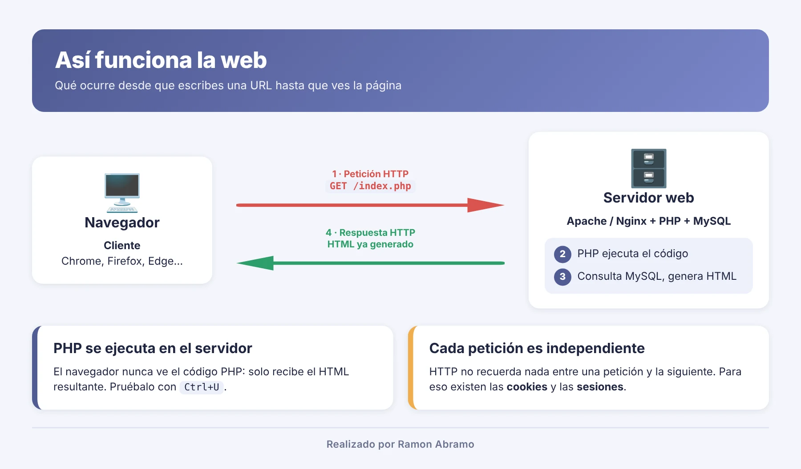
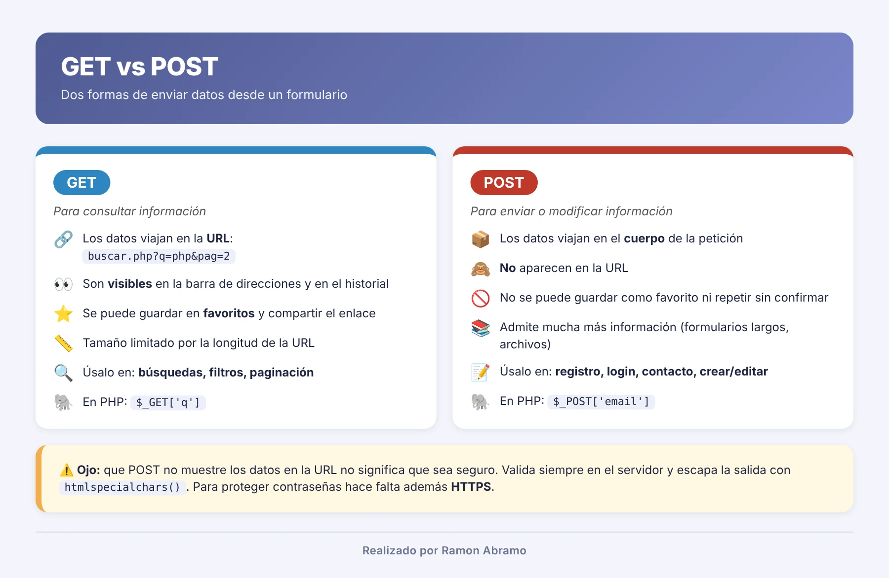

# Clase 1: Introducción a PHP y a la programación web

## Objetivos

- Entender qué ocurre desde que escribes una URL hasta que ves la página.
- Saber qué es PHP, dónde se ejecuta y qué diferencia hay con HTML o JavaScript.
- Comprobar que el entorno de desarrollo funciona (`phpinfo`).
- Enviar datos al servidor con formularios (GET y POST) y procesarlos con PHP.
- Conocer desde el primer día un riesgo de seguridad básico: XSS.

## Cómo funciona la web (resumen)

- **PHP se ejecuta siempre en el servidor.** El navegador solo recibe el resultado (HTML).
- **Cada petición es independiente**: HTTP no recuerda nada entre una petición y la siguiente (más adelante veremos sesiones y cookies).

## Ejemplos

| Carpeta | Qué enseña |
|---------|-----------|
| [`01-hola-mundo`](01-hola-mundo/) | Etiquetas `<?php ?>` y `<?= ?>`, variables, mezcla de HTML y PHP, ver el código fuente en el navegador |
| [`02-phpinfo`](02-phpinfo/) | `phpinfo()`: versión, extensiones, `php.ini`. Por qué no se debe dejar en producción |
| [`03-peticion-servidor`](03-peticion-servidor/) | `$_SERVER`, cabeceras HTTP y `$_GET`: qué recibe PHP en cada petición |
| [`04-formulario-get`](04-formulario-get/) | Formulario GET: datos en la URL, `$_GET`, buscador sencillo |
| [`05-formulario-post`](05-formulario-post/) | Formulario POST: `$_POST`, validación en el servidor, mantener los valores y mostrar errores |
| [`06-seguridad-xss`](06-seguridad-xss/) | Qué es XSS y cómo evitarlo con `htmlspecialchars()` |

Abre `http://localhost/cursoPoo2026/01-introduccion/` para ver el índice.

## Actividades propuestas

1. En `01-hola-mundo`, muestra tu nombre y el día de la semana en español.
2. En `02-phpinfo`, localiza la versión de PHP, la ruta del `php.ini` y comprueba si la extensión `pdo_mysql` está cargada.
3. En `04-formulario-get`, añade más lenguajes a la lista y un segundo filtro.
4. En `05-formulario-post`, añade un campo «teléfono» con su validación.
5. Con F12 → *Network*, compara una petición GET y una POST. ¿Dónde viajan los datos?

## Conceptos clave

| Concepto | Idea |
|----------|------|
| Cliente / servidor | El navegador pide, el servidor responde |
| HTTP | Protocolo de petición y respuesta (métodos, cabeceras, códigos de estado) |
| GET vs POST | GET: datos en la URL, para consultar. POST: datos en el cuerpo, para enviar/modificar |
| Validación en servidor | Nunca confíes en los datos del usuario |
| Escapar la salida | `htmlspecialchars()` evita inyección de código (XSS) |

> Antes de empezar, revisa la [guía del entorno](../00-entorno/README.md).

## Próxima clase

Fundamentos del lenguaje: variables, tipos de datos, operadores y estructuras de control.
