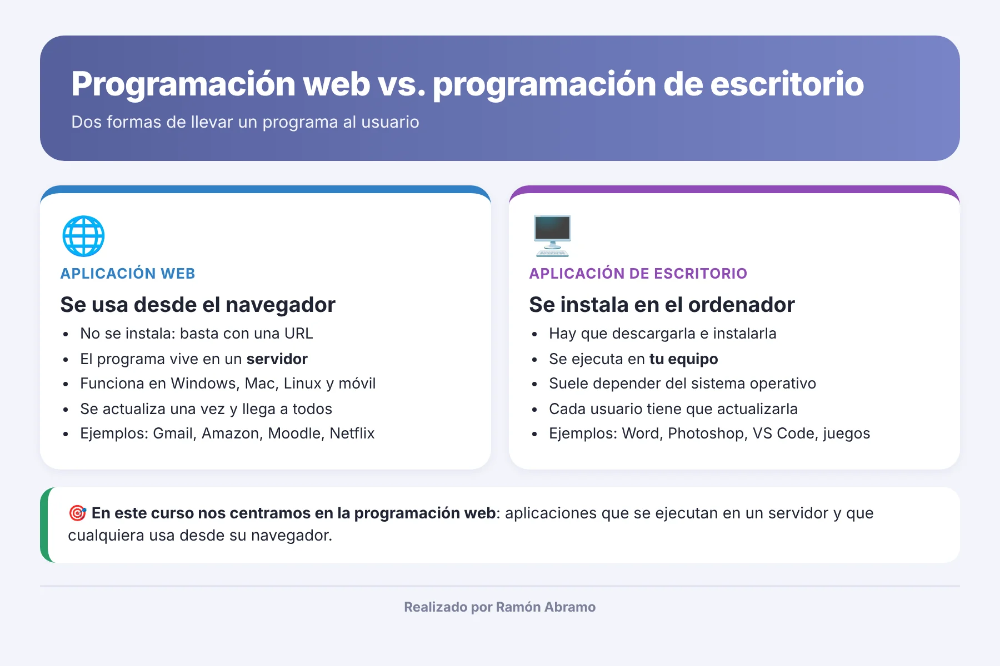
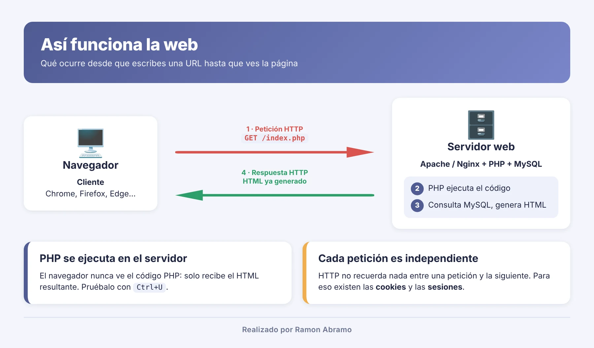
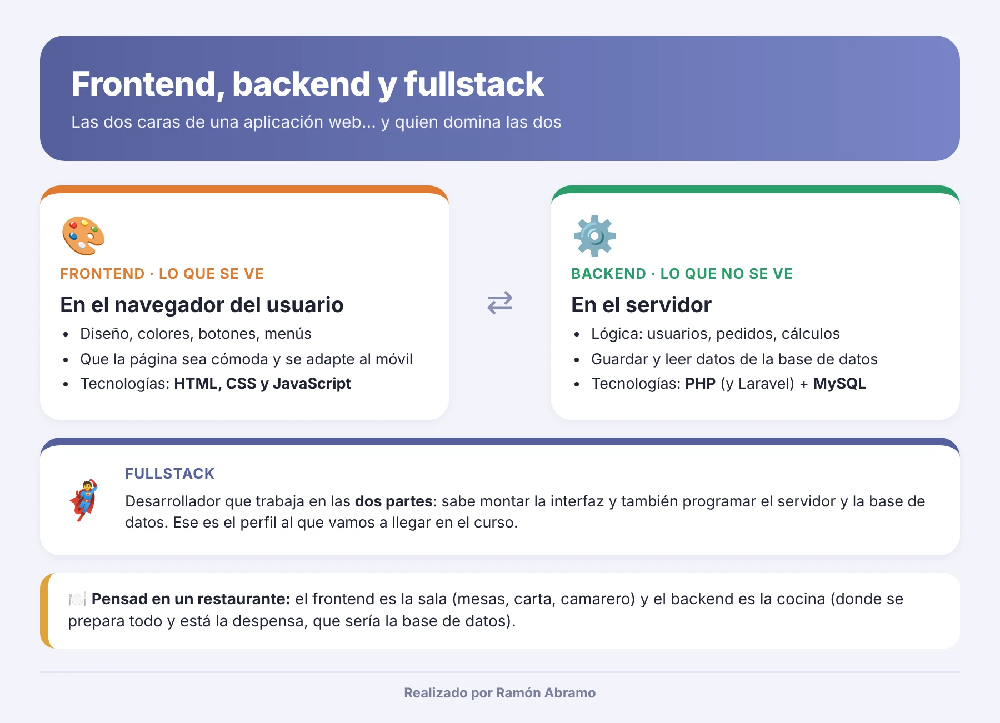
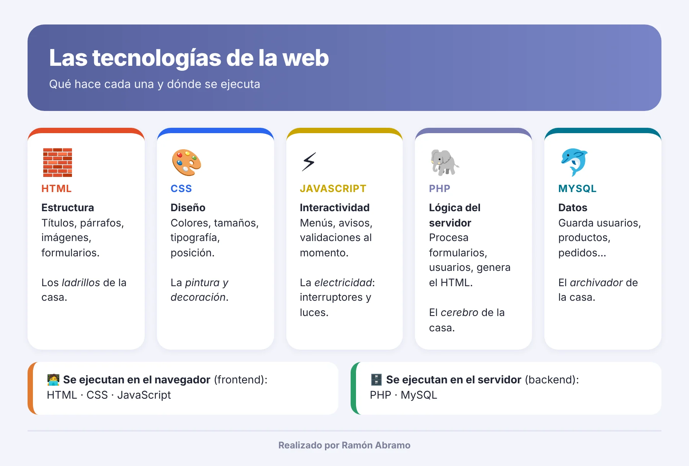

# Clase 1 · El mundo de la programación hoy

Buenas, soy **Ramón Abramo**, profesor con más de 25 años de experiencia docente, y hoy empezamos este viaje juntos. 👋

Esta primera clase es **solo teoría**. No vamos a instalar nada ni a escribir ni una línea de código. Mi objetivo es que, al terminar, sepáis situaros: qué tipos de programación existen, qué hace cada tecnología y qué camino vamos a recorrer durante el curso. Cuando lleguemos a PHP, a MySQL o a Laravel, ya sabréis dónde encaja cada pieza.

Así que tranquilos. Hoy toca escuchar, preguntar y hacerse una idea del mapa.

---

## Índice

1. [¿Qué es programar?](#-qué-es-programar)
2. [Programación de escritorio y programación web](#-programación-de-escritorio-y-programación-web)
3. [Cómo funciona la web: cliente y servidor](#-cómo-funciona-la-web-cliente-y-servidor)
4. [Frontend, backend y fullstack](#-frontend-backend-y-fullstack)
5. [Las tecnologías que vamos a usar](#-las-tecnologías-que-vamos-a-usar)
6. [Lo que os vais a encontrar en el curso](#-lo-que-os-vais-a-encontrar-en-el-curso)
7. [Vocabulario de hoy](#-vocabulario-de-hoy)

---

##  ¿Qué es programar?

Programar es **darle instrucciones a un ordenador** para que haga una tarea. Nada más… y nada menos.

El ordenador es muy rápido, pero no piensa: hace exactamente lo que le decimos, en el orden en que se lo decimos. Si la instrucción está mal, el resultado estará mal. Por eso os repetiré muchas veces que el ordenador nunca se equivoca: nos equivocamos nosotros al explicarle las cosas. 😉

Esas instrucciones se escriben en un **lenguaje de programación**: PHP, JavaScript, Python, Java, C#… Cada uno tiene sus reglas (su *sintaxis*) y está pensado para unos usos concretos.

---

##  Programación de escritorio y programación web

Hoy en día hay dos grandes formas de hacer llegar un programa al usuario.

### 🖥️ Aplicaciones de escritorio

Son las que **descargáis e instaláis** en vuestro ordenador: Word, Photoshop, un juego, el propio editor de código que usaremos. Se ejecutan en vuestro equipo y suelen depender del sistema operativo (una versión para Windows, otra para Mac…). Si sale una actualización, cada usuario tiene que instalarla.

### 🌐 Aplicaciones web

Son las que usáis **desde el navegador**: Gmail, Amazon, Netflix, la plataforma de vuestro banco o Moodle. No instaláis nada: escribís una dirección y listo. El programa vive en un **servidor** (un ordenador que está en algún lugar de internet, encendido siempre) y vuestro navegador solo muestra el resultado.

Fijaos en la ventaja: funciona igual en Windows, en Mac, en Linux o en el móvil, y cuando el programador la actualiza, la actualiza para todos a la vez.

| | Escritorio 🖥️ | Web 🌐 |
|---|---|---|
| ¿Hay que instalarla? | Sí | No, basta con el navegador |
| ¿Dónde se ejecuta? | En vuestro ordenador | En un servidor |
| ¿Depende del sistema operativo? | Normalmente sí | No |
| Actualizaciones | Cada usuario la actualiza | Se actualiza una vez para todos |
| Ejemplos | Word, Photoshop, juegos | Gmail, Amazon, Moodle |

> 🎯 **En este curso nos centramos en la programación web.** Vamos a construir aplicaciones que se ejecutan en un servidor y que cualquiera puede usar desde su navegador.

---

##  Cómo funciona la web: cliente y servidor

Cada vez que abrís una página web ocurre siempre lo mismo, aunque no lo veáis:

1. 🧑‍💻 **El cliente pide.** Vuestro navegador (Chrome, Firefox, Edge…) envía una **petición** al servidor: «dame la página `index.php`».
2. 🗄️ **El servidor trabaja.** Un programa llamado **servidor web** (por ejemplo, Apache) recibe la petición. Si la página es de PHP, PHP ejecuta el código y, si hace falta, consulta la base de datos MySQL.
3. 📄 **El servidor responde.** Devuelve al navegador una **respuesta** con la página ya terminada, en HTML.
4. 👀 **El navegador muestra.** Interpreta ese HTML, le aplica el diseño (CSS) y la interactividad (JavaScript), y os enseña la página.

El idioma en el que hablan navegador y servidor se llama **HTTP** (o HTTPS, su versión segura, la del candado 🔒) [5].

Ahora, un detalle que os va a ahorrar muchos dolores de cabeza: **el navegador nunca ve el código PHP**. Solo recibe el HTML que PHP ha generado. Lo que pasa en el servidor, se queda en el servidor.

---

##  Frontend, backend y fullstack

Una aplicación web tiene dos caras, y en el mundo laboral cada una tiene su nombre.

### 🎨 Frontend: lo que se ve

Es todo lo que ocurre **en el navegador del usuario**: el diseño, los colores, los botones, los menús, que la página se adapte bien al móvil. El frontend trabaja con **HTML, CSS y JavaScript**.

### ⚙️ Backend: lo que no se ve

Es lo que ocurre **en el servidor**: comprobar el usuario y la contraseña, calcular el total de un pedido, guardar un registro, enviar un correo. El backend trabaja con lenguajes como **PHP** y con bases de datos como **MySQL**.

### 🦸 Fullstack: las dos cosas

Un desarrollador **fullstack** sabe moverse en las dos partes: monta la interfaz y también programa el servidor y la base de datos. No hace falta ser un experto absoluto en todo, pero sí entender cómo encajan las piezas.

> 🍽️ **Pensad en un restaurante.** El frontend es la sala: las mesas, la carta, el camarero que os atiende. El backend es la cocina, donde se prepara todo y donde está la despensa (la base de datos). El cliente nunca entra en la cocina, pero sin cocina no hay comida.

Nuestro curso está centrado en el **backend con PHP**, aunque usaremos HTML, CSS y algo de JavaScript para que nuestras páginas tengan buena cara. Al final, con Laravel, tendréis una visión bastante completa de cómo se construye una aplicación de principio a fin.

---

##  Las tecnologías que vamos a usar

Para entender qué hace cada una, os propongo una analogía: construir una casa. 🏠

### 🧱 HTML: la estructura

**HTML** (*HyperText Markup Language*) no es un lenguaje de programación, es un **lenguaje de marcado**. Sirve para decir *qué hay* en la página: un título, un párrafo, una imagen, un enlace, un formulario. Son los **ladrillos y las paredes** de la casa [2].

### 🎨 CSS: el diseño

**CSS** (*Cascading Style Sheets*) dice *cómo se ve* cada cosa: colores, tamaños, tipos de letra, márgenes, posición. Es la **pintura y la decoración** [3]. El mismo HTML con otro CSS puede parecer una web totalmente distinta.

### ⚡ JavaScript: la interactividad

**JavaScript** sí es un lenguaje de programación, y se ejecuta **en el navegador**. Hace que la página reaccione: un menú que se despliega, un aviso si dejáis un campo vacío, una galería de fotos que se mueve. Es la **instalación eléctrica**: interruptores, luces, timbre [4].

Ojo con el nombre. JavaScript **no tiene nada que ver con Java**, por mucho que se parezcan. Es como el coche y el cochinillo. 🐷

### 🐘 PHP: la lógica del servidor

**PHP** es el lenguaje que vamos a aprender en profundidad. Se ejecuta **en el servidor** y su trabajo es generar páginas dinámicas: páginas cuyo contenido cambia según el usuario, la hora o los datos guardados [1]. Lo usan WordPress, Moodle y frameworks como Laravel, así que una parte enorme de la web funciona con PHP. Es el **cerebro** de la casa: decide qué hay que hacer en cada momento.

### 🐬 MySQL: los datos

**MySQL** es un **sistema gestor de bases de datos**. Guarda la información de forma ordenada, en tablas: usuarios, productos, pedidos, notas… Para hablar con MySQL se usa otro lenguaje, **SQL** [6]. Es el **archivador** de la casa: todo lo que hay que recordar se guarda ahí.

### 🚀 Laravel: el framework

Un **framework** es un conjunto de herramientas y una forma organizada de trabajar que nos ahorra reinventar la rueda. **Laravel** es el framework de PHP más utilizado hoy en día, y será la meta final del curso [7]. Pero no os adelantéis: primero hay que aprender a andar con PHP «a pelo».

### 📋 Resumen en una tabla

| Tecnología | ¿Qué hace? | ¿Dónde se ejecuta? | ¿Es lenguaje de programación? |
|---|---|---|---|
| 🧱 HTML | Estructura y contenido | Navegador | No (lenguaje de marcado) |
| 🎨 CSS | Diseño y presentación | Navegador | No (lenguaje de estilos) |
| ⚡ JavaScript | Interactividad | Navegador | Sí |
| 🐘 PHP | Lógica del servidor | Servidor | Sí |
| 🐬 MySQL | Guardar y consultar datos | Servidor | Es un gestor de bases de datos; se maneja con SQL |

---

##  Lo que os vais a encontrar en el curso

Os cuento el camino para que sepáis hacia dónde vamos:

1. 🛠️ **Preparar el entorno.** Instalaremos **Laragon**, que nos da en un solo paquete un servidor web (Apache), PHP y MySQL en nuestro propio ordenador. Así podremos programar como si tuviéramos un servidor de verdad.
2. 🧩 **Preparar el editor.** Configuraremos **Visual Studio Code** con las extensiones que nos harán la vida más fácil.
3. 🐘 **PHP desde cero.** Variables, condiciones, bucles, arrays, funciones y formularios. La base de todo.
4. 🐬 **Bases de datos con MySQL.** Aprenderemos SQL y conectaremos PHP con MySQL.
5. 🧱 **Programación orientada a objetos.** Clases, objetos, herencia… La forma en que se organiza el código profesional, y el corazón de este curso.
6. 🏗️ **Nuestro propio MVC.** Construiremos un pequeño framework para entender qué hay «debajo del capó».
7. 🚀 **Laravel.** Con todo lo anterior, aprenderemos a desarrollar aplicaciones completas con el framework más usado de PHP.

Iremos paso a paso. Cada clase se apoya en la anterior, así que si algo no os queda claro, preguntad. No existen las preguntas tontas: tontería es quedarse con la duda.

---

##  Vocabulario de hoy

| Término | Significado |
|---|---|
| **Cliente** | El programa que pide la página; normalmente, el navegador |
| **Servidor** | Ordenador (y programa) que recibe peticiones y devuelve respuestas |
| **Servidor web** | Programa que atiende las peticiones HTTP; en nuestro caso, Apache |
| **HTTP / HTTPS** | Protocolo con el que se comunican navegador y servidor; la S indica conexión cifrada |
| **Frontend** | Parte de la aplicación que se ve y se ejecuta en el navegador |
| **Backend** | Parte de la aplicación que se ejecuta en el servidor |
| **Fullstack** | Perfil que trabaja tanto en frontend como en backend |
| **Base de datos** | Lugar donde se guarda la información de forma organizada |
| **SQL** | Lenguaje para consultar y modificar bases de datos |
| **Framework** | Conjunto de herramientas y normas para desarrollar más rápido y de forma ordenada |

---

**Próxima clase:** instalamos el entorno de desarrollo con Laragon. 👉 [Clase 2 · Entorno de desarrollo con Laragon](../clase-02-entorno-laragon/README.md)

---

### Fuentes y Documentación Oficial

1. [PHP: ¿Qué es PHP? — Manual oficial de PHP](https://www.php.net/manual/es/intro-whatis.php)
2. [MDN Web Docs: HTML](https://developer.mozilla.org/es/docs/Web/HTML)
3. [MDN Web Docs: CSS](https://developer.mozilla.org/es/docs/Web/CSS)
4. [MDN Web Docs: JavaScript](https://developer.mozilla.org/es/docs/Web/JavaScript)
5. [MDN Web Docs: Generalidades del protocolo HTTP](https://developer.mozilla.org/es/docs/Web/HTTP/Overview)
6. [MySQL 8.0 Reference Manual: What is MySQL?](https://dev.mysql.com/doc/refman/8.0/en/what-is-mysql.html)
7. [Laravel: documentación oficial](https://laravel.com/docs)
