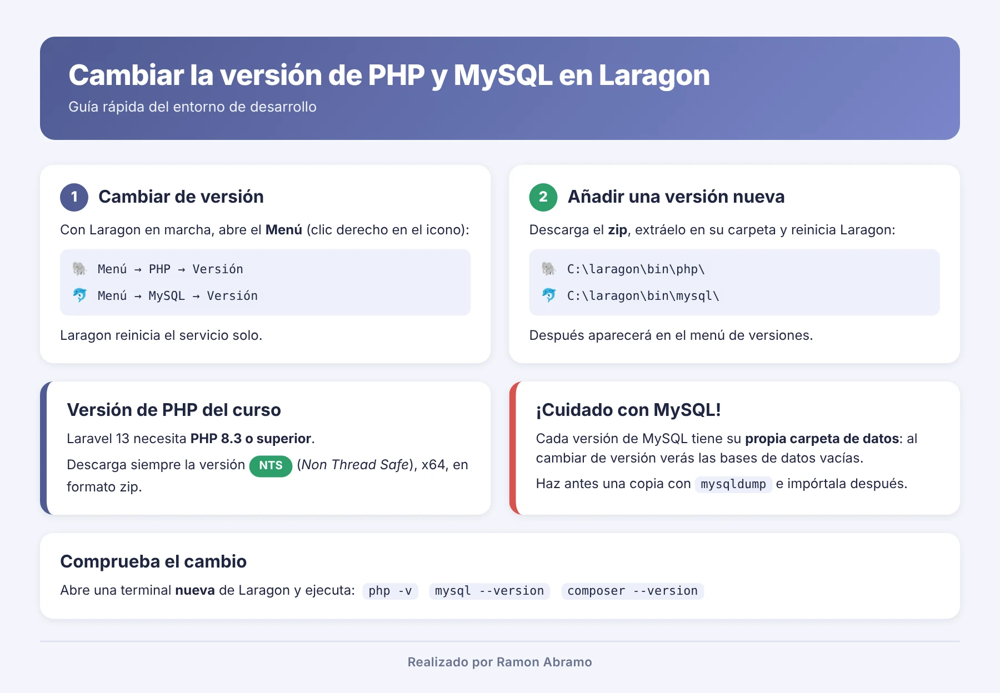
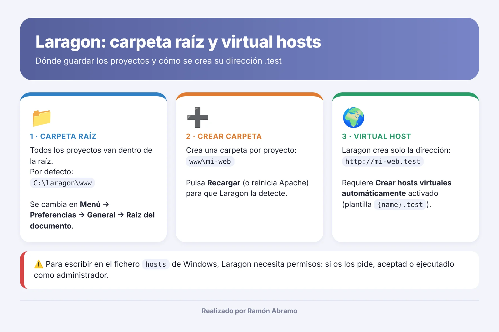

# Clase 2 · Entorno de desarrollo con Laragon

<p align="center"></p>

> 📕 **Apuntes en PDF:** [clase-02-entorno-laragon.pdf](clase-02-entorno-laragon.pdf)

En la clase anterior os conté que PHP se ejecuta en un **servidor**. Pues bien, hoy vamos a montar ese servidor… en vuestro propio ordenador. 💻

Para eso usaremos **Laragon**, un programa para Windows que trae en un solo paquete todo lo que necesitamos: el servidor web **Apache**, **PHP**, la base de datos **MySQL**, el gestor de bases de datos **HeidiSQL** y **Composer**. Lo instalamos, pulsamos un botón y tenemos un servidor completo funcionando en local.

Al terminar esta clase sabréis instalar Laragon, cambiar la versión de PHP y de MySQL, elegir la carpeta donde guardáis los proyectos y entender cómo Laragon crea direcciones del tipo `http://mi-proyecto.test`.

---

## Índice

1. [¿Por qué Laragon 6?](#-por-qué-laragon-6)
2. [Instalación](#-instalación)
3. [Conociendo Laragon](#-conociendo-laragon)
4. [Cambiar la versión de PHP (siempre NTS)](#-cambiar-la-versión-de-php-siempre-nts)
5. [Cambiar la versión de MySQL](#-cambiar-la-versión-de-mysql)
6. [La carpeta raíz de los proyectos](#-la-carpeta-raíz-de-los-proyectos)
7. [Virtual hosts automáticos](#-virtual-hosts-automáticos)
8. [Problemas habituales](#-problemas-habituales)
9. [Lista de comprobación](#-lista-de-comprobación)

---

##  ¿Por qué Laragon 6?

Vamos a usar **Laragon 6.0** porque es **la última versión con licencia gratuita**. Las versiones posteriores necesitan licencia de pago.

> ⚠️ **No actualicéis Laragon** aunque el programa os lo sugiera. Si os aparece un aviso de actualización, cerradlo. Nos quedamos en la 6.0.

Laragon 6 viene de serie con **PHP 8.1** y **MySQL 8.0**. Para empezar nos sirve, pero más adelante, cuando lleguemos a Laravel, necesitaremos una versión de PHP más moderna. Por eso hoy aprendemos a cambiarla.

---

##  Instalación

1. 📥 Descargad **Laragon 6.0** en su versión *Full* desde la página de versiones del proyecto: <https://github.com/leokhoa/laragon/releases> [1].
2. ▶️ Ejecutad el instalador y dejad la ruta por defecto: `C:\laragon`.
3. 🚀 Abrid Laragon y pulsad **Iniciar todo**. Deben ponerse en marcha **Apache** y **MySQL**.
4. 🌐 Abrid el navegador y escribid `http://localhost`. Si veis la página de bienvenida de Laragon, todo está funcionando.

¿A que no ha costado tanto? Ya tenéis un servidor web en casa. 🎉

---

##  Conociendo Laragon

La ventana principal tiene pocos botones, pero los vamos a usar a diario:

| Botón | Qué hace |
|---|---|
| ▶️ **Iniciar todo** | Arranca Apache y MySQL |
| ⏹️ **Detener** | Para los servicios |
| 🌐 **Web** | Abre `http://localhost` en el navegador |
| 🗄️ **Base de datos** | Abre HeidiSQL para gestionar MySQL (usuario `root`, sin contraseña) |
| 💻 **Terminal** | Abre una consola con PHP, MySQL y Composer ya configurados |
| 📁 **Raíz** | Abre la carpeta donde se guardan los proyectos (`C:\laragon\www`) |
| 🔄 **Recargar** | Reinicia los servicios y aplica los cambios (por ejemplo, nuevos virtual hosts) |

Y luego está el **Menú**, que es donde está todo lo demás. Se abre con **clic derecho sobre la ventana de Laragon** o sobre su icono junto al reloj de Windows, o con el botón **Menú**.

Para comprobar qué versiones estáis usando, abrid la **Terminal** de Laragon y escribid:

```bash
php -v
mysql --version
composer --version
```

---

##  Cambiar la versión de PHP (siempre NTS)



### Elegir una versión que ya tenéis instalada

1. Abrid el **Menú → PHP → Versión**.
2. Elegid la versión que queráis.
3. Laragon reinicia Apache solo. Comprobadlo con `php -v` en una terminal **nueva**.

### Añadir una versión nueva de PHP

Aquí viene lo importante, así que atentos. 👀

1. Id a la página oficial de descargas de PHP para Windows: <https://windows.php.net/download/> [3][4].
2. Buscad la versión que queráis (para el curso, **PHP 8.3** o superior) y descargad el **zip** de la variante:
   - **x64**
   - **NTS** (*Non Thread Safe*)

   > 🚨 **Tiene que ser la versión NTS.** Si descargáis la *Thread Safe* (TS), el entorno os dará errores. Fijaos bien en el nombre del zip: debe contener `nts`, por ejemplo `php-8.3.x-nts-Win32-vs16-x64.zip`.

3. Descomprimid el zip en una **carpeta nueva** dentro de `C:\laragon\bin\php\`. Por ejemplo:

   ```text
   C:\laragon\bin\php\php-8.3.x-nts-Win32-vs16-x64\
   ```

   Dentro de esa carpeta debe estar directamente el archivo `php.exe`, no otra subcarpeta.

4. Volved a Laragon, abrid el **Menú → PHP → Versión** y seleccionad la nueva.
5. Comprobad el cambio con `php -v` en una terminal nueva.

> 💡 Cada versión de PHP tiene su propio `php.ini` (**Menú → PHP → php.ini**) y sus propias extensiones (**Menú → PHP → Extensiones**). Si al cambiar de versión algo deja de funcionar, lo primero es revisar que las extensiones que necesitáis, como `pdo_mysql`, estén activadas.

### ¿Qué versión vamos a usar?

| Etapa del curso | Versión de PHP |
|---|---|
| PHP básico y orientación a objetos | La 8.1 que trae Laragon nos vale |
| Laravel 13 | **PHP 8.3 NTS o superior** (obligatorio) [7] |

Mi recomendación: instalad ya la **8.3 NTS** y trabajad con ella desde el principio. Así no tendréis sorpresas más adelante.

---

##  Cambiar la versión de MySQL

### Elegir una versión que ya tenéis instalada

1. **Menú → MySQL → Versión** y elegid la que queráis.
2. Laragon detiene MySQL y arranca la versión elegida.

### Añadir una versión nueva de MySQL

1. Descargad el **ZIP Archive** de *Windows (x86, 64-bit)* desde la página oficial: <https://dev.mysql.com/downloads/mysql/> [5].
2. Descomprimidlo en una carpeta nueva dentro de `C:\laragon\bin\mysql\`. Por ejemplo:

   ```text
   C:\laragon\bin\mysql\mysql-8.4.x-winx64\
   ```

3. Reiniciad Laragon y seleccionad la nueva versión en **Menú → MySQL → Versión**.

> 😱 **¡Cuidado! Los datos no se pasan solos de una versión a otra.** Cada versión de MySQL guarda sus datos en su propia carpeta (`C:\laragon\data\...`). Así que, al cambiar, veréis las bases de datos **vacías**. No se han borrado: siguen en la versión anterior.
>
> Si queréis llevároslas, haced antes una copia con `mysqldump` [6]:
>
> 1. Con la versión antigua activa: `mysqldump -u root --all-databases > copia.sql`
> 2. Cambiad a la versión nueva.
> 3. Importad la copia: `mysql -u root < copia.sql`

---

##  La carpeta raíz de los proyectos



La **carpeta raíz** (en inglés, *Document Root*) es la carpeta donde Laragon busca vuestros proyectos web. Por defecto es:

```text
C:\laragon\www
```

Cada proyecto será **una carpeta dentro de `www`**. Por ejemplo, `C:\laragon\www\php-basico`. El botón **Raíz** de Laragon os abre esa carpeta directamente.

### ¿Y si quiero usar otra carpeta?

Puede que prefiráis guardar los proyectos en otro sitio, como `D:\proyectos` o una carpeta sincronizada. Se cambia así:

1. Abrid **Menú → Preferencias**.
2. En la pestaña **General**, buscad el campo **Raíz del documento** (*Document Root*).
3. Pulsad el botón para cambiarla y elegid la nueva carpeta.
4. Cerrad las preferencias y pulsad **Recargar**.

A partir de ese momento, Laragon buscará los proyectos en la nueva carpeta. Los proyectos que tuvierais en la antigua no se mueven solos: si los queréis, copiadlos vosotros.

---

##  Virtual hosts automáticos

Esta es una de las funciones que más me gustan de Laragon. Fijaos.

Normalmente, para abrir un proyecto escribiríais algo como `http://localhost/php-basico/`. Funciona, pero es largo y poco realista. Laragon hace algo mejor: **por cada carpeta que creáis en la raíz, crea automáticamente una dirección propia**, lo que se llama un **virtual host** [2]:

| Carpeta | Dirección automática |
|---|---|
| `C:\laragon\www\php-basico` | `http://php-basico.test` |
| `C:\laragon\www\mi-tienda` | `http://mi-tienda.test` |
| `C:\laragon\www\cursoPoo2026` | `http://cursopoo2026.test` |

### ¿Cómo lo hace?

Cuando pulsáis **Recargar** (o arrancáis Laragon), Laragon:

1. 🔍 Revisa las carpetas que hay en la raíz.
2. ⚙️ Crea la configuración de Apache para cada una.
3. 📝 Añade la dirección al fichero `hosts` de Windows, para que `php-basico.test` apunte a vuestro propio ordenador.

Por eso, a veces, Windows os pedirá **permiso de administrador**: Laragon necesita escribir en ese fichero. Aceptad.

### Dónde se configura

En **Menú → Preferencias → General**:

- ✅ **Crear hosts virtuales automáticamente** (*Auto virtual hosts*): tiene que estar marcado.
- 🏷️ **Plantilla del nombre de host** (*Hostname template*): por defecto `{name}.test`, donde `{name}` es el nombre de la carpeta.

### Probadlo ahora

1. Pulsad **Raíz** y cread una carpeta llamada `prueba`.
2. Pulsad **Recargar**.
3. Abrid `http://prueba.test` en el navegador.

Si veis el listado de la carpeta (vacía) o una página de Laragon, ¡enhorabuena! Acabáis de crear vuestro primer virtual host. 🥳

---

##  Problemas habituales

| Problema | Qué revisar |
|---|---|
| `php -v` sigue mostrando la versión antigua | Cerrad la terminal y abrid una nueva, mejor la de Laragon |
| Apache no arranca tras cambiar de PHP | Habéis descargado la versión **Thread Safe**: bajad la **NTS**. Comprobad también que `php.exe` está directamente en la carpeta |
| El puerto 80 o 3306 está ocupado | Cerrad otros programas que lo usen (Skype, IIS, otro MySQL) o cambiad el puerto en **Menú → Preferencias → Servicios y puertos** |
| `mi-proyecto.test` no carga | Pulsad **Recargar**. Si sigue sin funcionar, abrid Laragon como administrador |
| Han desaparecido mis bases de datos | Estáis en otra versión de MySQL: volved a la anterior o importad una copia |
| Falta una extensión de PHP | **Menú → PHP → Extensiones** |

---

##  Lista de comprobación

Antes de la próxima clase, comprobad que:

- [ ] Laragon 6.0 está instalado y **Iniciar todo** arranca Apache y MySQL.
- [ ] `http://localhost` muestra la página de Laragon.
- [ ] `php -v` muestra **PHP 8.3 NTS** (o la versión que hayáis elegido).
- [ ] Sabéis cambiar la versión de PHP y de MySQL desde el **Menú**.
- [ ] Sabéis dónde está la carpeta raíz y cómo cambiarla.
- [ ] `http://prueba.test` funciona.

---

**Clase anterior:** 👈 [Clase 1 · El mundo de la programación hoy](../clase-01-mundo-programacion/README.md)
**Próxima clase:** 👉 [Clase 3 · Visual Studio Code y sus extensiones](../clase-03-visual-studio-code/README.md)

---

### Fuentes y Documentación Oficial

1. [Laragon: página de versiones del proyecto en GitHub](https://github.com/leokhoa/laragon/releases)
2. [Laragon: documentación oficial](https://laragon.org/docs/)
3. [PHP para Windows: descargas oficiales](https://windows.php.net/download/)
4. [Manual de PHP: instalación en Windows](https://www.php.net/manual/es/install.windows.php)
5. [MySQL Community Server: descargas oficiales](https://dev.mysql.com/downloads/mysql/)
6. [MySQL 8.0 Reference Manual: mysqldump](https://dev.mysql.com/doc/refman/8.0/en/mysqldump.html)
7. [Laravel: requisitos de instalación](https://laravel.com/docs/13.x/installation)
