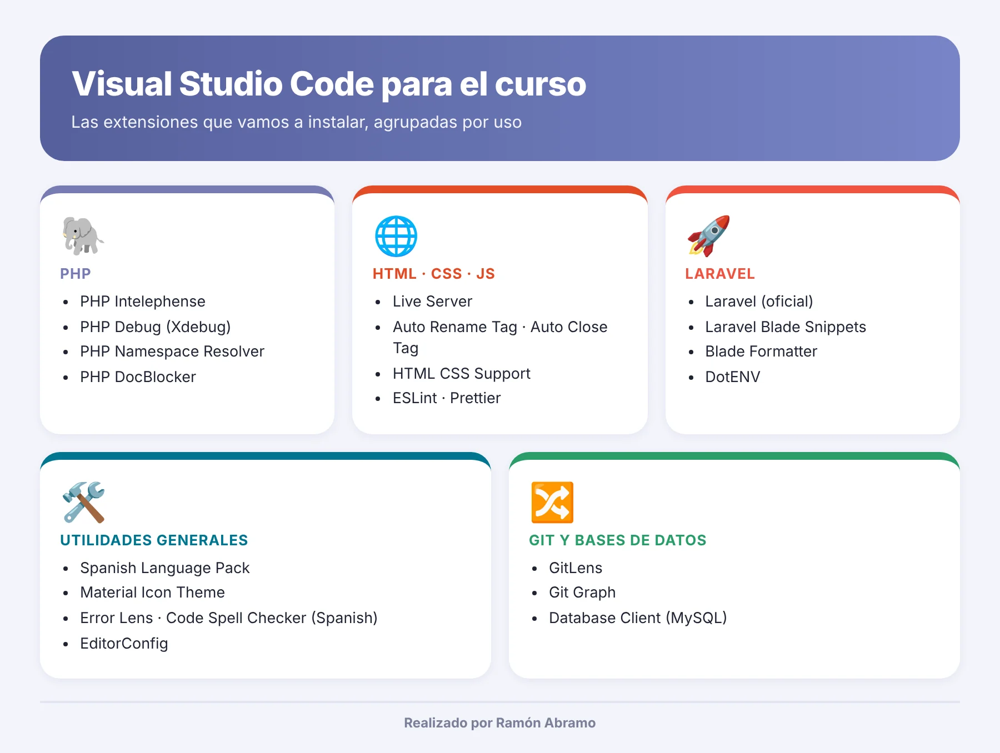

# Clase 3 · Visual Studio Code y sus extensiones

<p align="center"></p>

> 📕 **Apuntes en PDF:** [clase-03-visual-studio-code.pdf](clase-03-visual-studio-code.pdf)

Ya tenemos el servidor funcionando. Ahora nos falta el sitio donde vamos a escribir el código: el **editor**. 🧑‍💻

En el curso usaremos **Visual Studio Code** (VS Code para los amigos). Es gratuito, funciona en Windows, Mac y Linux, y es el editor más utilizado del mundo para desarrollo web. Por sí solo ya es muy bueno, pero su verdadera fuerza está en las **extensiones**: pequeños complementos que le añaden funciones. Hoy os enseño cuáles vamos a instalar y para qué sirve cada una.



---

## Índice

1. [Instalar Visual Studio Code](#-instalar-visual-studio-code)
2. [Cómo instalar una extensión](#-cómo-instalar-una-extensión)
3. [Extensiones generales](#-extensiones-generales)
4. [Extensiones para PHP](#-extensiones-para-php)
5. [Extensiones para HTML, CSS y JavaScript](#-extensiones-para-html-css-y-javascript)
6. [Extensiones para Laravel](#-extensiones-para-laravel)
7. [Extensiones para Git y bases de datos](#-extensiones-para-git-y-bases-de-datos)
8. [Instalarlas todas de golpe](#-instalarlas-todas-de-golpe)
9. [Ajustes recomendados](#-ajustes-recomendados)
10. [Atajos de teclado imprescindibles](#-atajos-de-teclado-imprescindibles)

---

##  Instalar Visual Studio Code

1. Descargadlo desde la página oficial: <https://code.visualstudio.com/> [1].
2. Durante la instalación, marcad estas dos casillas (os ahorrarán tiempo):
   - ✅ **Agregar la acción "Abrir con Code"** al menú contextual de archivos y carpetas.
   - ✅ **Agregar a PATH**, para poder abrirlo desde la terminal con el comando `code`.
3. Abrid VS Code y, para trabajar en un proyecto, usad siempre **Archivo → Abrir carpeta** y elegid la carpeta del proyecto dentro de `C:\laragon\www`.

> 💡 Abrid siempre la **carpeta** del proyecto, no un archivo suelto. Así VS Code entiende el proyecto completo y las extensiones funcionan mucho mejor.

---

##  Cómo instalar una extensión

1. Pulsad el icono de **Extensiones** en la barra lateral izquierda (los cuatro cuadraditos) o el atajo `Ctrl + Shift + X`.
2. Escribid el nombre de la extensión en el buscador.
3. **Comprobad el autor** antes de instalar: hay muchas extensiones con nombres parecidos. En las tablas de abajo os indico el identificador exacto (autor.nombre).
4. Pulsad **Instalar** [2].

> ⚠️ Más extensiones no significa mejor editor. Cada una consume memoria y algunas se pisan entre sí. Instalad las de esta lista y poco más.

---

##  Extensiones generales

Las primeras, para que el editor sea más cómodo en cualquier lenguaje.

| Extensión | Identificador | ¿Para qué sirve? |
|---|---|---|
| 🇪🇸 Spanish Language Pack | `MS-CEINTL.vscode-language-pack-es` | Pone VS Code en español |
| 📂 Material Icon Theme | `PKief.material-icon-theme` | Iconos distintos para cada tipo de archivo: encontraréis todo más rápido |
| 🚨 Error Lens | `usernamehw.errorlens` | Muestra los errores en la misma línea donde ocurren, sin tener que pasar el ratón |
| 📝 Code Spell Checker | `streetsidesoftware.code-spell-checker` | Detecta faltas de ortografía en el código y los comentarios |
| 🇪🇸 Spanish - Code Spell Checker | `streetsidesoftware.code-spell-checker-spanish` | Añade el diccionario en español al anterior |
| 🧹 EditorConfig | `EditorConfig.EditorConfig` | Respeta las normas de formato del proyecto (sangría, finales de línea…) |

---

##  Extensiones para PHP

Las más importantes del curso. Sin ellas, VS Code entiende PHP a medias.

| Extensión | Identificador | ¿Para qué sirve? |
|---|---|---|
| 🐘 **PHP Intelephense** | `bmewburn.vscode-intelephense-client` | **Imprescindible.** Autocompletado, errores mientras escribís, ir a la definición de una función, documentación al pasar el ratón [6] |
| 🐞 PHP Debug | `xdebug.php-debug` | Permite depurar paso a paso con Xdebug (lo veremos más adelante) |
| 📦 PHP Namespace Resolver | `MehediDracula.php-namespace-resolver` | Añade y ordena los `use` de las clases. Muy útil cuando lleguemos a la orientación a objetos |
| 📄 PHP DocBlocker | `neilbrayfield.php-docblocker` | Genera los comentarios de documentación `/** ... */` de funciones y clases |

> 🛠️ **Truco con Intelephense.** VS Code trae su propio soporte básico de PHP y choca con Intelephense. Desactivadlo: en Extensiones, buscad `@builtin php`, entrad en **PHP Language Features** y pulsad **Deshabilitar**. Dejad activo **PHP Language Basics**, que es el que colorea el código [3].

---

##  Extensiones para HTML, CSS y JavaScript

Aunque nuestro curso se centra en PHP, vamos a escribir mucho HTML y algo de CSS y JavaScript.

| Extensión | Identificador | ¿Para qué sirve? |
|---|---|---|
| 🔴 Live Server | `ritwickdey.LiveServer` | Abre páginas HTML y las recarga sola al guardar. **Ojo:** solo para HTML, CSS y JS; los `.php` los abriremos siempre con Laragon |
| 🏷️ Auto Rename Tag | `formulahendry.auto-rename-tag` | Si cambiáis `<div>` por `<section>`, cambia también la etiqueta de cierre |
| 🔒 Auto Close Tag | `formulahendry.auto-close-tag` | Cierra las etiquetas HTML automáticamente |
| 🎨 HTML CSS Support | `ecmel.vscode-html-css` | Autocompleta en el HTML las clases e identificadores definidos en el CSS |
| ✅ ESLint | `dbaeumer.vscode-eslint` | Avisa de errores y malas prácticas en JavaScript |
| ✨ Prettier | `esbenp.prettier-vscode` | Formatea automáticamente HTML, CSS y JavaScript para que quede ordenado |

> 💡 VS Code ya trae de serie **Emmet**: escribid `!` en un archivo HTML vacío y pulsad `Tab`. Os genera la estructura completa de una página [5]. Magia. ✨

---

##  Extensiones para Laravel

Estas no las necesitaréis hasta el final del curso, pero las dejo apuntadas para tener el editor preparado.

| Extensión | Identificador | ¿Para qué sirve? |
|---|---|---|
| 🚀 **Laravel** (oficial) | `laravel.vscode-laravel` | Extensión oficial del equipo de Laravel: autocompletado de rutas, vistas, configuración, traducciones, validación y más [7] |
| 🗡️ Laravel Blade Snippets | `onecentlin.laravel-blade` | Colorea la sintaxis de las plantillas Blade y añade fragmentos de código |
| 🧽 Blade Formatter | `shufo.vscode-blade-formatter` | Formatea los archivos `.blade.php` |
| ⚙️ DotENV | `mikestead.dotenv` | Colorea los archivos `.env` de configuración |

---

##  Extensiones para Git y bases de datos

| Extensión | Identificador | ¿Para qué sirve? |
|---|---|---|
| 🔍 GitLens | `eamodio.gitlens` | Muestra quién cambió cada línea y cuándo, y mucho más sobre el historial |
| 🌳 Git Graph | `mhutchie.git-graph` | Dibuja el historial de commits y ramas como un gráfico |
| 🐬 Database Client | `cweijan.vscode-mysql-client2` | Permite conectarse a MySQL y lanzar consultas sin salir del editor (como alternativa a HeidiSQL) |

---

##  Instalarlas todas de golpe

Si marcasteis **Agregar a PATH** al instalar VS Code, podéis instalarlas todas desde la terminal. Copiad este bloque en una terminal (por ejemplo, la de Laragon) y esperad:

```bash
code --install-extension MS-CEINTL.vscode-language-pack-es
code --install-extension PKief.material-icon-theme
code --install-extension usernamehw.errorlens
code --install-extension streetsidesoftware.code-spell-checker
code --install-extension streetsidesoftware.code-spell-checker-spanish
code --install-extension EditorConfig.EditorConfig
code --install-extension bmewburn.vscode-intelephense-client
code --install-extension xdebug.php-debug
code --install-extension MehediDracula.php-namespace-resolver
code --install-extension neilbrayfield.php-docblocker
code --install-extension ritwickdey.LiveServer
code --install-extension formulahendry.auto-rename-tag
code --install-extension formulahendry.auto-close-tag
code --install-extension ecmel.vscode-html-css
code --install-extension dbaeumer.vscode-eslint
code --install-extension esbenp.prettier-vscode
code --install-extension laravel.vscode-laravel
code --install-extension onecentlin.laravel-blade
code --install-extension shufo.vscode-blade-formatter
code --install-extension mikestead.dotenv
code --install-extension eamodio.gitlens
code --install-extension mhutchie.git-graph
code --install-extension cweijan.vscode-mysql-client2
```

Cuando termine, cerrad y abrid VS Code.

---

##  Ajustes recomendados

Abrid los ajustes en formato JSON con `Ctrl + Shift + P` → **Preferencias: Abrir configuración de usuario (JSON)** y añadid estas líneas dentro de las llaves:

```json
{
    "editor.formatOnSave": true,
    "editor.tabSize": 4,
    "files.autoSave": "afterDelay",
    "files.encoding": "utf8",
    "php.validate.executablePath": "C:\\laragon\\bin\\php\\php-8.3.x-nts-Win32-vs16-x64\\php.exe",
    "[php]": {
        "editor.defaultFormatter": "bmewburn.vscode-intelephense-client"
    }
}
```

| Ajuste | Qué hace |
|---|---|
| `editor.formatOnSave` | Ordena el código cada vez que guardáis |
| `editor.tabSize` | Sangría de 4 espacios, la habitual en PHP |
| `files.autoSave` | Guarda solo, para que no se os olvide antes de recargar el navegador |
| `files.encoding` | Guarda en UTF-8: adiós a las tildes y eñes rotas |
| `php.validate.executablePath` | Ruta al `php.exe` de Laragon. **Cambiadla** por la carpeta exacta de vuestra versión |
| `[php]` → `editor.defaultFormatter` | Usa Intelephense para formatear PHP |

---

##  Atajos de teclado imprescindibles

| Atajo | Acción |
|---|---|
| `Ctrl + S` | Guardar [4] |
| `Ctrl + P` | Buscar y abrir un archivo del proyecto por su nombre |
| `Ctrl + Shift + P` | Paleta de comandos: desde aquí se hace todo |
| `Ctrl + ñ` | Abrir o cerrar la terminal integrada (teclado español) |
| `Ctrl + B` | Mostrar u ocultar la barra lateral |
| `Ctrl + /` | Comentar o descomentar la línea (en teclado español puede ser `Ctrl + Shift + 7`) |
| `Alt + ↑` / `Alt + ↓` | Mover la línea arriba o abajo |
| `Shift + Alt + ↓` | Duplicar la línea |
| `Ctrl + D` | Seleccionar la siguiente aparición de la palabra (edición múltiple) |
| `Shift + Alt + F` | Formatear el documento |

> 🎯 Os reto a usar `Ctrl + P` y `Ctrl + Shift + P` durante toda la semana. Cuando os acostumbréis, no volveréis a buscar archivos con el ratón.

---

##  Lista de comprobación

- [ ] VS Code instalado y en español.
- [ ] PHP Intelephense instalado y **PHP Language Features** deshabilitado.
- [ ] El resto de extensiones de la lista instaladas.
- [ ] `php.validate.executablePath` apunta al `php.exe` de vuestra versión de Laragon.
- [ ] Sabéis abrir una carpeta de `C:\laragon\www` con **Archivo → Abrir carpeta**.

---

**Clase anterior:** 👈 [Clase 2 · Entorno de desarrollo con Laragon](../clase-02-entorno-laragon/README.md)
**Próxima clase:** 👉 [Clases 4 a 6 · Primeros pasos con PHP](../clase-04-primeros-pasos-php/README.md)

---

### Fuentes y Documentación Oficial

1. [Visual Studio Code: descarga oficial](https://code.visualstudio.com/)
2. [Visual Studio Code: Extension Marketplace](https://code.visualstudio.com/docs/editor/extension-marketplace)
3. [Visual Studio Code: PHP en VS Code](https://code.visualstudio.com/docs/languages/php)
4. [Visual Studio Code: atajos de teclado para Windows (PDF)](https://code.visualstudio.com/shortcuts/keyboard-shortcuts-windows.pdf)
5. [Visual Studio Code: Emmet en VS Code](https://code.visualstudio.com/docs/editor/emmet)
6. [Visual Studio Marketplace: PHP Intelephense](https://marketplace.visualstudio.com/items?itemName=bmewburn.vscode-intelephense-client)
7. [Visual Studio Marketplace: Laravel (extensión oficial)](https://marketplace.visualstudio.com/items?itemName=laravel.vscode-laravel)
