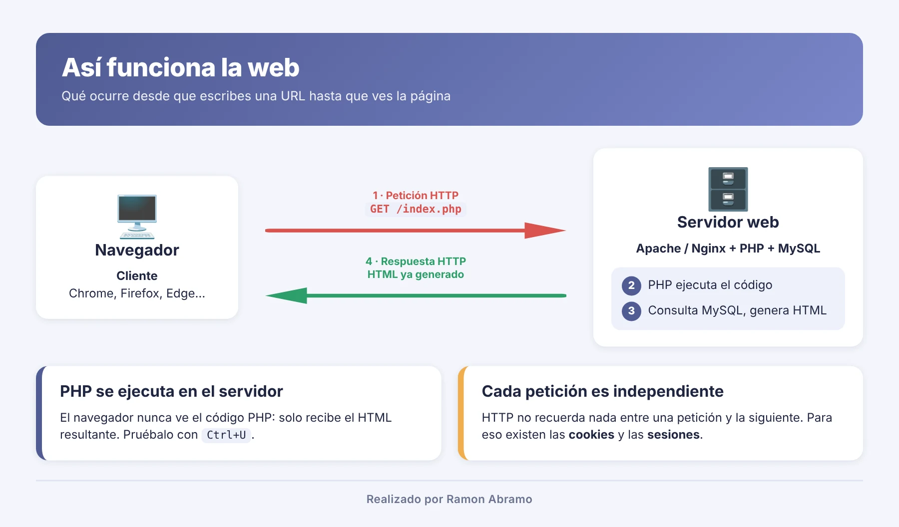
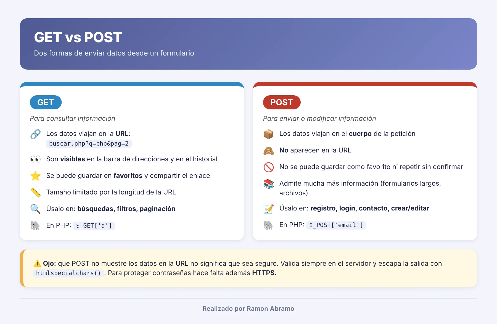

# Clases 4 a 6 · Primeros pasos con PHP

<p align="center"></p>

¡Por fin! Tenemos el servidor, tenemos el editor… y hoy escribimos nuestro primer código. 🎉

Este bloque nos va a llevar **unas tres clases**. Os aviso de algo importante desde el principio: **son ejemplos de introducción**. Quiero que veáis cómo funciona la programación web con PHP, que escribáis código, que lo probéis y que perdáis el miedo. No vamos a profundizar en cada tema: en las clases siguientes volveremos sobre todo esto con calma y en detalle.

Así que no os agobiéis si algo no queda claro del todo. Ahora toca **probar, romper y volver a probar**.

---

## Índice

- [Cómo vamos a trabajar](#-cómo-vamos-a-trabajar)
- **Clase 4**
  1. [Qué es PHP y cómo funciona una petición](#-1-qué-es-php-y-cómo-funciona-una-petición)
  2. [Vuestro primer ejemplo: phpinfo()](#-2-vuestro-primer-ejemplo-phpinfo)
  3. [Vuestro primer script: hola.php](#-3-vuestro-primer-script-holaphp)
  4. [Sintaxis básica](#-4-sintaxis-básica)
  5. [Variables y tipos de datos](#-5-variables-y-tipos-de-datos)
  6. [Operadores](#-6-operadores)
- **Clase 5**
  7. [Condicionales](#-7-condicionales)
  8. [switch y match](#-8-switch-y-match)
  9. [Bucles](#-9-bucles)
  10. [Llaves o sintaxis alternativa](#-10-llaves-o-sintaxis-alternativa)
  11. [Arrays](#-11-arrays)
  12. [Funciones](#-12-funciones)
- **Clase 6**
  13. [Formularios: GET y POST](#-13-formularios-get-y-post)
  14. [Errores frecuentes](#-14-errores-frecuentes)
  15. [Conectar con MySQL](#-15-conectar-con-mysql)
  16. [Ejercicios propuestos](#-16-ejercicios-propuestos)
  17. [Glosario](#-17-glosario)

---

##  Cómo vamos a trabajar

Durante estas tres clases trabajaremos en **un único proyecto** llamado `php-basico`:

1. Pulsad **Iniciar todo** en Laragon.
2. Pulsad **Raíz** (se abre `C:\laragon\www`) y cread la carpeta **`php-basico`**.
3. Abrid esa carpeta en VS Code con **Archivo → Abrir carpeta**.
4. Pulsad **Recargar** en Laragon para que cree el virtual host.
5. Cada archivo que creéis se abrirá en `http://php-basico.test/nombre-del-archivo.php`.

Para cada tema seguiremos siempre el mismo método:

| Paso | Qué hacer |
|---|---|
| 01 📖 | Leed la explicación |
| 02 ⌨️ | **Escribid** el ejemplo vosotros (nada de copiar y pegar) y probadlo |
| 03 ✅ | Comprobad el resultado con las pruebas que os propongo |

> 📁 En la carpeta [`ejemplos/`](ejemplos/) de este repositorio tenéis todos los ejemplos ya escritos, numerados en orden. Usadlos para **comparar** cuando algo no os funcione, no para saltaros el paso de escribirlos.

---

# 🗓️ Clase 4

##  1. Qué es PHP y cómo funciona una petición

PHP es un lenguaje de programación que se ejecuta **en el servidor** y genera páginas web dinámicas: su contenido cambia según el usuario, la hora o los datos guardados. Lo usan WordPress, Moodle y frameworks como Laravel [1].



¿Qué pasa cuando abrís `http://php-basico.test/hola.php`?

```text
 Navegador  ──1──▶  Apache  ──2──▶  PHP  ◀──3──▶  MySQL
 (pide hola.php)    (servidor web)  (ejecuta      (datos, si
                                     el código)    hacen falta)
      ◀────────────── 4 · Apache devuelve SOLO HTML ──────────
```

El código PHP **nunca sale del servidor**. Al navegador solo le llega el HTML que PHP ha generado.

### PHP frente a JavaScript

| | ⚡ JavaScript (navegador) | 🐘 PHP |
|---|---|---|
| Dónde se ejecuta | En el ordenador del usuario | En el servidor |
| Quién ve el código | Cualquiera, con «Ver código fuente» | Nadie: solo llega el HTML |
| Para qué se usa | Interactividad de la página | Formularios, bases de datos, usuarios |
| Extensión del archivo | `.js` | `.php` |

> ⚠️ **Fijaos:** un archivo `.php` **no funciona con doble clic**. Necesita un servidor web con PHP, y eso es exactamente lo que nos da Laragon.

---

##  2. Vuestro primer ejemplo: phpinfo()

Antes de escribir código de verdad, vamos a comprobar **qué características tiene nuestro servidor**. PHP incluye para ello la función `phpinfo()`, que muestra su configuración completa [2].

🎯 **Objetivo:** ver la configuración de PHP en `http://php-basico.test/info.php`.

```php
<?php
phpinfo();
```

📄 Ejemplo: [`01-info.php`](ejemplos/01-info.php)

**Hacedlo en este orden:**

1. En VS Code, dentro de `php-basico`, cread el archivo **`info.php`** con el código de arriba.
2. Guardadlo.
3. Abrid `http://php-basico.test/info.php` en el navegador.

### ¿Para qué sirve phpinfo()?

`phpinfo()` **no crea páginas para vuestros usuarios**: sirve para **comprobar las características del servidor**. Cuando algo no funciona, es lo primero que se mira.

| Dato | Qué os dice |
|---|---|
| **PHP Version** | La versión de PHP que está en uso (la que elegisteis en Laragon) |
| **Server API** | Cómo ejecuta Apache a PHP: «Apache 2.0 Handler» (módulo, PHP *Thread Safe*) o «CGI/FastCGI» (*Non Thread Safe*) |
| **Loaded Configuration File** | El `php.ini` que está leyendo PHP. Ahí se activan extensiones y se configuran los errores |
| **display_errors** | Si PHP muestra los errores en pantalla. Buscadlo con `Ctrl + F` |
| **pdo_mysql** y **mysqli** | Extensiones para conectar con MySQL. Las usaremos en el punto 15 |

### ✅ Dos pruebas para comprobarlo

| Haced esto | Debéis obtener |
|---|---|
| Abrid `http://php-basico.test/info.php` | Una página con la cabecera «PHP Version» y vuestra versión |
| Pulsad `Ctrl + F` y buscad `pdo_mysql` | Una sección con «PDO Driver for MySQL: enabled» |

> 🔐 **Fijaos:** `phpinfo()` revela datos delicados del servidor. Usadlo solo en vuestro equipo y **borrad `info.php`** antes de subir una web a internet.

---

##  3. Vuestro primer script: hola.php

Ahora sí, vuestro primer script de verdad. Un clásico. 😄

🎯 **Objetivo:** ejecutar vuestro primer script en `http://php-basico.test/hola.php`.

```php
<?php
echo "¡Hola, mundo!";
```

📄 Ejemplo: [`02-hola.php`](ejemplos/02-hola.php)

1. En `php-basico`, cread **`hola.php`** con el código de arriba.
2. Guardad. No hace falta pulsar Recargar: el virtual host ya existe.
3. Abrid `http://php-basico.test/hola.php`.

### ✅ Dos pruebas para comprobarlo

| Haced esto | Debéis obtener |
|---|---|
| Abrid `http://php-basico.test/hola.php` | El texto ¡Hola, mundo! |
| Clic derecho en la página → **Ver código fuente** | Solo el texto: ni rastro de `<?php` |

> ⚠️ Si en la barra de direcciones pone `file:///`, habéis abierto el archivo con doble clic y PHP no se ejecuta. Debe empezar por `http://`.

---

##  4. Sintaxis básica

El código PHP va entre `<?php` y `?>`, y **cada instrucción termina en punto y coma**. Lo que queda fuera de esas etiquetas se envía tal cual al navegador.

### Mezclar PHP y HTML

```php
<!DOCTYPE html>
<html lang="es">
<body>
    <h1>Mi primera página PHP</h1>
    <p>Hoy es <?php echo date("d/m/Y"); ?></p>
</body>
</html>
```

📄 Ejemplo: [`03-fecha.php`](ejemplos/03-fecha.php)

### Mostrar información y comentar

```php
<?php
echo "Hola";                      // la forma más usada
echo "Hola", " ", "mundo";        // admite varios valores
echo "<strong>Negrita</strong>";  // también genera HTML
/* Comentario de
   varias líneas */
```

📄 Ejemplo: [`04-echo-comentarios.php`](ejemplos/04-echo-comentarios.php)

### El echo corto: `<?=`

Cuando mezcláis PHP y HTML, vais a escribir muchísimas veces `<?php echo ...; ?>` solo para mostrar un valor. Para eso PHP tiene un atajo: el **echo corto** (también llamado echo contraído), `<?=`.

Estas dos líneas hacen exactamente lo mismo:

```php
<p>Hoy es <?php echo date("d/m/Y"); ?></p>
<p>Hoy es <?= date("d/m/Y") ?></p>
```

Fijaos en lo que desaparece: la palabra `echo` y el punto y coma final. `<?=` ya significa «abre PHP y muestra esto», y el `?>` de cierre hace de punto y coma.

| Forma larga | Echo corto |
|---|---|
| `<?php echo $nombre; ?>` | `<?= $nombre ?>` |
| `<?php echo date("Y"); ?>` | `<?= date("Y") ?>` |
| `<?php echo "Hola, $nombre"; ?>` | `<?= "Hola, $nombre" ?>` |

¿Cuándo usar cada uno?

- Para **mostrar un único valor dentro del HTML**, el echo corto: queda más limpio y se lee mejor.
- Para **varias instrucciones** (asignar variables, `if`, bucles…), la etiqueta normal `<?php ... ?>`. Dentro de `<?=` solo cabe una expresión que mostrar.

> 💡 El echo corto **siempre está disponible** desde PHP 5.4 y no depende de ninguna configuración [8]. No lo confundáis con la etiqueta corta `<?` a secas (sin `php` ni `=`): esa sí depende de la opción `short_open_tag` y os recomiendo no usarla nunca.

> ⚠️ **Curiosidad que os puede costar un rato:** PHP busca sus etiquetas en todo el archivo, **también dentro de los comentarios HTML** (`<!-- -->`). Si escribís `<?=` dentro de un comentario HTML, PHP intentará ejecutarlo y os dará un *Parse error*.

📄 Ejemplo: [`03-fecha.php`](ejemplos/03-fecha.php) (incluye las dos formas)

Lo volveréis a ver en las plantillas con formularios y en el ejemplo completo con MySQL, y más adelante en Laravel, cuyas vistas Blade usan una idea parecida con `{{ }}`.

### Reglas que conviene recordar

| Regla | Ejemplo |
|---|---|
| Cada instrucción termina en `;` | `echo "Hola";` |
| Las variables distinguen mayúsculas | `$nombre` y `$Nombre` son distintas |
| Si el archivo es solo PHP, omitid el `?>` final | Evita espacios en blanco accidentales |

> 😅 **Fijaos:** olvidar el `;` es el error número uno al empezar. PHP señala la línea **siguiente** a la que tiene el fallo.

---

##  5. Variables y tipos de datos

Una variable es un espacio con nombre donde guardáis un dato. En PHP **siempre empieza por `$`** y no hay que declarar su tipo: PHP lo deduce del valor.

```php
<?php
$nombre = "Lucía";
$edad = 25;
echo "Me llamo $nombre y tengo $edad años.";
```

📄 Ejemplo: [`05-variables.php`](ejemplos/05-variables.php)

### Cómo nombrar variables

| Correcto ✅ | Incorrecto ❌ | Por qué |
|---|---|---|
| `$edad` | `edad` | Falta el `$` |
| `$dato1` | `$1dato` | No puede empezar por número |
| `$precioTotal` | `$precio total` | Sin espacios: usad *camelCase* |
| `$anio` | `$año` | Evitad tildes y eñes |

### Tipos de datos básicos

| Tipo | Qué guarda | Ejemplo |
|---|---|---|
| `int` | Números enteros | `$edad = 25;` |
| `float` | Decimales (con punto, no coma) | `$precio = 19.99;` |
| `string` | Texto entre comillas | `$ciudad = "Santander";` |
| `bool` | Verdadero o falso | `$activo = true;` |
| `array` | Varios valores | `$notas = [7, 8, 9];` |
| `null` | Sin valor | `$resultado = null;` |

### var_dump(), comillas y constantes

Mientras programáis, `var_dump()` muestra el **tipo** y el **valor** de una variable. Va a ser vuestra mejor herramienta para encontrar errores.

```php
<?php
$precio = 19.99;
var_dump($precio);    // float(19.99)
var_dump("19.99");    // string(5) "19.99"
```

Con **comillas dobles** PHP sustituye las variables; con **comillas simples**, no:

```php
<?php
$nombre = "Ana";
echo "Hola $nombre";   // Hola Ana      → sustituye la variable
echo 'Hola $nombre';   // Hola $nombre  → texto literal
```

Las **constantes** guardan un valor que **no cambia** durante la ejecución. No llevan `$` y, por convenio, se escriben en mayúsculas:

```php
<?php
const IVA = 0.21;
define("NOMBRE_WEB", "Mi tienda");

$precio = 100;
echo "Precio con IVA: " . $precio * (1 + IVA);   // 121
```

📄 Ejemplo: [`06-var-dump-comillas-constantes.php`](ejemplos/06-var-dump-comillas-constantes.php)

### ✅ Dos pruebas para comprobarlo

| Haced esto | Debéis obtener |
|---|---|
| Ejecutad `variables.php` | Me llamo Lucía y tengo 25 años. |
| Cambiad las comillas dobles por simples | Aparecen `$nombre` y `$edad` sin sustituir |

---

##  6. Operadores

Los operadores sirven para calcular, comparar y unir valores. El que más confunde al principio es el **punto (`.`)**, que en PHP une textos.

### Aritméticos

| Operador | Operación | Ejemplo | Resultado |
|---|---|---|---|
| `+` | Suma | `7 + 2` | 9 |
| `-` | Resta | `7 - 2` | 5 |
| `*` | Multiplicación | `7 * 2` | 14 |
| `/` | División | `7 / 2` | 3.5 |
| `%` | Resto (módulo) | `7 % 2` | 1 |
| `**` | Potencia | `7 ** 2` | 49 |

### Asignación y concatenación

```php
<?php
$x = 10;    // asigna
$x += 5;    // $x = $x + 5  → 15
$x++;       // suma 1       → 16

$saludo = "Hola, " . "Pedro";   // Hola, Pedro
$saludo .= "!";                  // añade al final → Hola, Pedro!
```

### Comparación

| Operador | Significado | Ejemplo | Resultado |
|---|---|---|---|
| `==` | Igual valor | `5 == "5"` | `true` |
| `===` | Igual valor **y** tipo | `5 === "5"` | `false` |
| `!==` | Distinto valor o tipo | `5 !== "5"` | `true` |
| `<` `>` `<=` `>=` | Menor, mayor… | `5 >= 5` | `true` |

📄 Ejemplo: [`07-operadores.php`](ejemplos/07-operadores.php)

---

# 🗓️ Clase 5

##  7. Condicionales

### Operadores lógicos

| Operador | Significado | Es verdadero si… |
|---|---|---|
| `&&` | Y | Las dos condiciones son verdaderas |
| `\|\|` | O | Al menos una es verdadera |
| `!` | NO | La condición es falsa |

### Tomar decisiones: if, elseif, else

Un bloque se puede escribir de **dos formas equivalentes**: con **llaves `{ }`** o con la **sintaxis alternativa**, que cambia la llave de apertura por `:` y la de cierre por `endif;`.

<table>
<tr><th>Con llaves</th><th>Sintaxis alternativa</th></tr>
<tr><td>

```php
<?php
$nota = 7.5;

if ($nota >= 9) {
    echo "Sobresaliente";
} elseif ($nota >= 7) {
    echo "Notable";
} elseif ($nota >= 5) {
    echo "Aprobado";
} else {
    echo "Suspenso";
}
```

</td><td>

```php
<?php
$nota = 7.5;

if ($nota >= 9):
    echo "Sobresaliente";
elseif ($nota >= 7):
    echo "Notable";
elseif ($nota >= 5):
    echo "Aprobado";
else:
    echo "Suspenso";
endif;
```

</td></tr>
</table>

Las condiciones se revisan de arriba abajo y solo se ejecuta el **primer** bloque que se cumple: con `$nota = 7.5` se muestra Notable.

### Operador ternario: un if/else en una línea

```php
<?php
$edad = 16;
$mensaje = ($edad >= 18) ? "Mayor de edad" : "Menor de edad";
```

📄 Ejemplo: [`08-condicionales.php`](ejemplos/08-condicionales.php)

> ⚠️ **Fijaos:** `=` asigna y `===` compara. Escribir `if ($x = 5)` no compara: guarda un 5 en `$x` y la condición siempre se cumple.

---

##  8. switch y match

Cuando comparáis **una variable con varios valores concretos**, `switch` y `match` quedan más claros que una cadena de `elseif`.

```php
<?php
$dia = "sábado";

switch ($dia) {
    case "sábado":
    case "domingo":
        echo "Fin de semana";
        break;
    default:
        echo "Día laborable";
}
```

`match` llegó con PHP 8 y devuelve directamente un valor:

```php
<?php
$codigo = 404;

$texto = match ($codigo) {
    200 => "Correcto",
    404 => "Página no encontrada",
    500 => "Error del servidor",
    default => "Código desconocido",
};
echo $texto;   // Página no encontrada
```

| | `switch` | `match` |
|---|---|---|
| Compara con | `==` (solo valor) | `===` (valor y tipo) |
| Necesita `break` | Sí | No |
| Devuelve un valor | No | Sí |
| Sintaxis alternativa | Sí: `endswitch;` | No: solo llaves |

📄 Ejemplo: [`09-switch-match.php`](ejemplos/09-switch-match.php)

> ⚠️ **Fijaos:** sin `break`, `switch` sigue ejecutando los `case` de debajo.

---

##  9. Bucles

| Bucle | Usadlo cuando… |
|---|---|
| `for` | Sabéis cuántas veces repetir |
| `while` | Repetís mientras se cumpla una condición |
| `do…while` | El bloque debe ejecutarse al menos una vez |
| `foreach` | Recorréis los elementos de un array |

### for: tabla de multiplicar

```php
<?php
for ($i = 1; $i <= 10; $i++) {
    echo "5 x $i = ", 5 * $i, "<br>";
}
```

Sus tres partes: valor inicial (`$i = 1`), condición para seguir (`$i <= 10`) y cambio en cada vuelta (`$i++`).

### while: repetir mientras se cumpla

```php
<?php
$cuenta = 3;
while ($cuenta > 0) {
    echo "Quedan $cuenta<br>";
    $cuenta--;
}
```

> 🔁 **Fijaos:** si la condición nunca deja de cumplirse (por ejemplo, olvidáis `$cuenta--`), creáis un **bucle infinito** y la página se queda cargando.

📄 Ejemplo: [`10-bucles.php`](ejemplos/10-bucles.php)

### foreach, do…while, break y continue

```php
<?php
$frutas = ["manzana", "pera", "uva"];
foreach ($frutas as $fruta) {
    echo "$fruta<br>";
}

$n = 10;
do {
    echo "Se ejecuta una vez aunque la condición sea falsa";
} while ($n < 5);

for ($i = 1; $i <= 10; $i++) {
    if ($i % 2 == 0) continue;   // salta los pares
    if ($i > 7) break;           // termina al pasar de 7
    echo "$i ";                  // 1 3 5 7
}
```

`break` sale del bucle al momento; `continue` salta a la siguiente vuelta. `do…while` es el único bucle que **no tiene sintaxis alternativa**.

📄 Ejemplo: [`11-mas-bucles.php`](ejemplos/11-mas-bucles.php)

### ✅ Dos pruebas para comprobarlo

| Haced esto | Debéis obtener |
|---|---|
| Ejecutad el `for` con llaves y luego con `endfor;` | La misma tabla del 5 en los dos casos |
| Quitad el `endforeach;` del ejemplo alternativo | *Parse error*: PHP no encuentra el cierre del bloque |

---

##  10. Llaves o sintaxis alternativa

Todas las estructuras de bloque admiten las dos formas, salvo `do…while` y `match` [3].

| Estructura | Con llaves | Sintaxis alternativa |
|---|---|---|
| `if` | `if (...) { } elseif else` | `if (...): elseif (...): else: endif;` |
| `switch` | `switch (...) { }` | `switch (...): … endswitch;` |
| `for` | `for (...) { }` | `for (...): … endfor;` |
| `while` | `while (...) { }` | `while (...): … endwhile;` |
| `foreach` | `foreach (...) { }` | `foreach (...): … endforeach;` |
| `do…while`, `match` | Solo llaves | No existe |

### ¿Cuándo usar cada una?

- Para código PHP puro (cálculos, funciones, archivos que solo tienen PHP), las **llaves**.
- Para páginas que mezclan PHP y HTML, la **alternativa**: un `<?php endif; ?>` se distingue mucho mejor entre etiquetas que una `}` perdida.

```php
<?php if ($logueado): ?>
    <p>Bienvenido</p>
<?php else: ?>
    <a href="login.php">Entrar</a>
<?php endif; ?>
```

📄 Ejemplo: [`12-sintaxis-alternativa-html.php`](ejemplos/12-sintaxis-alternativa-html.php)

### Reglas que debéis recordar

- En cada estructura usad **una sola forma**: no mezcléis `{` con `endif;`.
- En la alternativa escribid **`elseif`** junto: `else if` da error.
- Cada cierre (`endif;`, `endfor;`…) lleva su **punto y coma**, salvo que justo después venga `?>`.
- En un `switch` alternativo no pongáis HTML ni espacios entre `switch (...):` y el primer `case`.

---

##  11. Arrays

Un array guarda varios valores en una sola variable. Los **indexados** usan posiciones numéricas que empiezan en 0; los **asociativos** usan claves con nombre.

```php
<?php
// Indexado
$colores = ["rojo", "verde", "azul"];
echo $colores[0];        // rojo (¡el primero es el 0!)
$colores[] = "negro";    // añade al final

// Asociativo
$alumno = ["nombre" => "Marta", "edad" => 22];
echo $alumno["nombre"];  // Marta

foreach ($alumno as $clave => $valor) {
    echo "$clave: $valor<br>";
}
```

### Arrays dentro de arrays

```php
<?php
$alumnos = [
    ["nombre" => "Marta", "nota" => 8],
    ["nombre" => "Luis",  "nota" => 6],
];
foreach ($alumnos as $a) {
    echo $a["nombre"] . " tiene un " . $a["nota"] . "<br>";
}
```

### Funciones útiles

| Función | Qué hace | Ejemplo |
|---|---|---|
| `count()` | Cuenta elementos | `count($colores)` → 4 |
| `in_array()` | ¿Existe el valor? | `in_array("rojo", $colores)` |
| `sort()` | Ordena de menor a mayor | `sort($numeros)` |
| `implode()` | Une en un texto | `implode(", ", $colores)` |
| `print_r()` | Muestra todo el array | `print_r($alumno)` |

📄 Ejemplo: [`13-arrays.php`](ejemplos/13-arrays.php)

---

##  12. Funciones

Una función es un bloque de código con nombre: lo escribís una vez y lo usáis las veces que queráis. Recibe datos (**parámetros**) y devuelve un resultado con **`return`**.

```php
<?php
function saludar($nombre) {
    return "Hola, $nombre";
}

echo saludar("Carlos");   // Hola, Carlos
echo saludar("Elena");    // Hola, Elena
```

### Parámetros con valor por defecto

```php
<?php
function calcularPrecio($base, $iva = 0.21) {
    return $base * (1 + $iva);
}

echo calcularPrecio(100);         // 121 (usa el 21 %)
echo calcularPrecio(100, 0.10);   // 110
```

### Declarar tipos

Indicar el tipo de los parámetros y del resultado hace el código más claro, y PHP avisa si recibe un dato incorrecto.

```php
<?php
function sumar(int $a, int $b): int {
    return $a + $b;
}

function esMayorDeEdad(int $edad): bool {
    return $edad >= 18;
}
```

📄 Ejemplo: [`14-funciones.php`](ejemplos/14-funciones.php)

> 💡 El cuerpo de una función **siempre se escribe con llaves**. La sintaxis alternativa solo existe para `if`, `switch` y los bucles.

### Ámbito: cada función tiene sus variables

Una función **no ve** las variables de fuera, y las que crea dentro desaparecen al terminar. Pasad siempre los datos como parámetros.

```php
<?php
$mensaje = "Hola";

function prueba() {
    echo $mensaje;     // Aviso: $mensaje no existe aquí
}

function pruebaBien($texto) {
    echo $texto;       // Correcto
}
pruebaBien($mensaje);
```

### Funciones de PHP que usaréis a menudo

| Función | Qué hace | Ejemplo |
|---|---|---|
| `strlen()` | Longitud de un texto | `strlen("Hola")` → 4 |
| `strtoupper()` | Pasa a mayúsculas | `strtoupper("php")` → PHP |
| `trim()` | Quita espacios sobrantes | `trim(" hola ")` → hola |
| `str_replace()` | Reemplaza texto | `str_replace("a", "o", "casa")` → coso |
| `round()` | Redondea | `round(3.567, 2)` → 3.57 |
| `rand()` | Número aleatorio | `rand(1, 6)` |
| `isset()` | ¿Existe y no es `null`? | `isset($_POST["email"])` |

📄 Ejemplo: [`15-ambito-funciones-internas.php`](ejemplos/15-ambito-funciones-internas.php)

### ✅ Dos pruebas para comprobarlo

| Haced esto | Debéis obtener |
|---|---|
| Llamad a `sumar(2, 3)` | 5 |
| Llamad a `prueba()` | Aviso «Undefined variable $mensaje» |

---

# 🗓️ Clase 6

##  13. Formularios: GET y POST

Aquí es donde la programación web cobra sentido: el usuario escribe algo, lo envía y nuestro PHP lo recibe. 🙌



PHP recibe los datos de un formulario en dos arrays especiales: **`$_GET`** y **`$_POST`** [4]. La clave de cada dato es el atributo `name` del campo.

| Método | Dónde viajan los datos | Usadlo para |
|---|---|---|
| GET | En la URL: `buscar.php?q=php` | Búsquedas y filtros que se pueden compartir |
| POST | Ocultos en la petición | Registros, contraseñas y datos que cambian algo |

### Un formulario GET

Un buscador sencillo. Fijaos en cómo aparece lo que escribís en la barra de direcciones:

```php
<?php
$q = trim($_GET["q"] ?? "");
?>
<form method="get">
    <input type="text" name="q" value="<?php echo htmlspecialchars($q); ?>">
    <button type="submit">Buscar</button>
</form>

<?php if ($q !== ""): ?>
    <p>Has buscado: <strong><?php echo htmlspecialchars($q); ?></strong></p>
<?php endif; ?>
```

📄 Ejemplo: [`16-buscar-get.php`](ejemplos/16-buscar-get.php)

### Un formulario POST con validación

🎯 **Objetivo:** crear `contacto.php`, un formulario que se envía a sí mismo, valida los datos y saluda al usuario. Como mezcla PHP con HTML, usa la **sintaxis alternativa**.

```php
<?php
$errores = [];
$nombre = "";

if ($_SERVER["REQUEST_METHOD"] === "POST") {
    $nombre = trim($_POST["nombre"] ?? "");
    $email  = trim($_POST["email"] ?? "");

    if ($nombre === "") {
        $errores[] = "El nombre es obligatorio.";
    }
    if (!filter_var($email, FILTER_VALIDATE_EMAIL)) {
        $errores[] = "El email no es válido.";
    }
}
?>
<?php if ($_SERVER["REQUEST_METHOD"] === "POST" && empty($errores)): ?>
    <p>Gracias, <?php echo htmlspecialchars($nombre); ?>.</p>
<?php else: ?>
    <?php foreach ($errores as $error): ?>
        <p style="color:red"><?php echo $error; ?></p>
    <?php endforeach; ?>
    <form method="post">
        Nombre: <input type="text" name="nombre"
                       value="<?php echo htmlspecialchars($nombre); ?>">
        Email: <input type="email" name="email">
        <button type="submit">Enviar</button>
    </form>
<?php endif; ?>
```

📄 Ejemplo: [`17-contacto.php`](ejemplos/17-contacto.php)

### ¿Qué hace cada parte?

| Código | Para qué sirve |
|---|---|
| `$_SERVER["REQUEST_METHOD"] === "POST"` | Saber si el formulario se ha enviado |
| `$_POST["nombre"] ?? ""` | Leer el dato o, si no llega, usar texto vacío |
| `trim()` | Quitar espacios al principio y al final |
| `filter_var(..., FILTER_VALIDATE_EMAIL)` | Comprobar que el email tiene formato válido |
| `htmlspecialchars()` | Mostrar el texto del usuario de forma segura [5] |

### 🛡️ La regla de oro: no os fiéis del usuario

- **Validad siempre en el servidor.** Las comprobaciones de HTML (`required`, `type="email"`) se pueden saltar fácilmente.
- **Escapad al mostrar.** Si alguien escribe `<script>` en su nombre y lo mostráis sin `htmlspecialchars()`, el navegador lo ejecuta. Es un ataque **XSS**.
- **Volved a rellenar los campos** con lo que escribió el usuario cuando hay errores, para que no tenga que repetirlo.

### ✅ Dos pruebas para comprobarlo

| Haced esto | Debéis obtener |
|---|---|
| Enviad el formulario vacío | Los dos mensajes de error en rojo |
| Escribid `<b>Ana</b>` como nombre y un email válido | Gracias, `<b>Ana</b>`. (con las etiquetas visibles, no en negrita) |

> ⚠️ **Fijaos:** el atributo `name` del input y la clave de `$_POST` deben coincidir exactamente, mayúsculas incluidas.

---

##  14. Errores frecuentes

Los errores al empezar casi siempre son los mismos. Antes de pedir ayuda, **leed el mensaje**: os dice **qué** falla y **en qué línea**.

| Lo que veis | Qué debéis revisar |
|---|---|
| `Parse error: syntax error` | Falta un `;`, una llave, un `endif;` o unas comillas. Mirad la línea indicada y la anterior |
| `Warning: Undefined variable` | La variable está mal escrita (¿mayúsculas?) o no se ha creado antes |
| `Warning: Undefined array key` | El campo no llegó en `$_POST`. Usad `?? ""` o `isset()` |
| Veis el código PHP en el navegador | Habéis abierto el archivo con doble clic. Usad `http://nombre.test/` |
| `nombre.test` no carga | Pulsad **Recargar** en Laragon. Si sigue, abridlo como administrador |
| Página en blanco | Hay un error y los avisos están ocultos (mirad abajo) |

### Ver todos los errores mientras desarrolláis

Laragon muestra los errores por defecto. Si veis una página en blanco, activadlos en el propio archivo:

```php
<?php
ini_set("display_errors", 1);
error_reporting(E_ALL);
```

📄 Ejemplo: [`18-mostrar-errores.php`](ejemplos/18-mostrar-errores.php)

O de forma permanente: clic derecho en Laragon → **PHP → php.ini**, poned `display_errors = On`, guardad y pulsad **Recargar**.

> 🔐 **Fijaos:** mostrar errores es solo para desarrollar. En un servidor real se desactivan, porque dan pistas a posibles atacantes.

---

##  15. Conectar con MySQL

Último paso de este bloque: guardar y leer datos de verdad. PHP se comunica con MySQL mediante la extensión **PDO** (*PHP Data Objects*) [6]. Funciona igual con distintas bases de datos y permite **consultas preparadas**, que protegen vuestros datos. En el curso usaremos solo PDO.

```text
 Script PHP  ──1──▶  PDO  ──2──▶  MySQL
 (pide datos         (abre la      (Laragon,
  con SQL)            conexión)     puerto 3306)
      ◀──── 3 · MySQL devuelve las filas y PDO se las entrega a PHP como arrays
```

> 📌 Esto es solo una primera toma de contacto. Más adelante dedicaremos un bloque entero a SQL y otro a PDO.

### Preparar la base de datos

🎯 **Objetivo:** crear la base de datos **`academia`** con una tabla **`alumnos`**.

1. En Laragon pulsad **Iniciar todo** y comprobad que MySQL está en marcha.
2. Pulsad **Base de datos** para abrir HeidiSQL y conectad (usuario `root`, sin contraseña).
3. Abrid una pestaña **Consulta**, pegad el SQL de abajo y ejecutadlo con **F9**.
4. Pulsad **F5** en el panel izquierdo: debe aparecer `academia` con la tabla `alumnos`.

```sql
CREATE DATABASE academia
    CHARACTER SET utf8mb4 COLLATE utf8mb4_unicode_ci;
USE academia;

CREATE TABLE alumnos (
    id INT AUTO_INCREMENT PRIMARY KEY,
    nombre VARCHAR(80) NOT NULL,
    email VARCHAR(120) NOT NULL,
    nota DECIMAL(4,2)
);

INSERT INTO alumnos (nombre, email, nota) VALUES
    ('Marta', 'marta@ejemplo.com', 8.50),
    ('Luis', 'luis@ejemplo.com', 6.00);
```

📄 Ejemplo: [`bd/academia.sql`](ejemplos/bd/academia.sql)

### La conexión

| Dato | Valor en Laragon |
|---|---|
| Servidor (host) | `localhost` |
| Puerto | `3306` (por defecto) |
| Usuario / contraseña | `root` / vacía |
| Base de datos | `academia` |
| Juego de caracteres | `utf8mb4` |

```php
<?php
$dsn = "mysql:host=localhost;dbname=academia;charset=utf8mb4";

try {
    $pdo = new PDO($dsn, "root", "", [
        PDO::ATTR_ERRMODE            => PDO::ERRMODE_EXCEPTION,
        PDO::ATTR_DEFAULT_FETCH_MODE => PDO::FETCH_ASSOC,
    ]);
} catch (PDOException $e) {
    die("Error de conexión: " . $e->getMessage());
}
```

📄 Ejemplo: [`bd/conexion.php`](ejemplos/bd/conexion.php)

| Pieza | Qué hace |
|---|---|
| `$dsn` | Indica el tipo de base de datos, el servidor, la base y los caracteres |
| `new PDO(...)` | Abre la conexión: recibe el DSN, el usuario, la contraseña y opciones |
| `ERRMODE_EXCEPTION` | Si una consulta falla, PHP lanza una excepción en vez de callar |
| `FETCH_ASSOC` | Cada fila llega como array asociativo: `$fila["nombre"]` |
| `try / catch` | Captura el fallo de conexión y muestra un mensaje |

> 🔐 `root` sin contraseña solo vale en vuestro equipo. En un servidor real se crea un usuario propio con los permisos justos.

### Probar la conexión

```php
<?php
require "conexion.php";
echo "Conexión correcta con MySQL " . $pdo->getAttribute(PDO::ATTR_SERVER_VERSION);
```

`require` incluye otro archivo PHP: así `conexion.php` se escribe una vez y se reutiliza en todos los scripts.

📄 Ejemplo: [`bd/probar.php`](ejemplos/bd/probar.php)

### Leer datos

PDO ofrece dos caminos: `query()` para consultas fijas y `prepare()` con `execute()` cuando intervienen valores variables.

```php
<?php
require "conexion.php";

$consulta = $pdo->query("SELECT nombre, nota FROM alumnos");

foreach ($consulta as $fila) {
    echo $fila["nombre"] . ": " . $fila["nota"] . "<br>";
}
```

📄 Ejemplo: [`bd/leer.php`](ejemplos/bd/leer.php)

| Método | Devuelve | Usadlo para |
|---|---|---|
| `fetch()` | Una fila, o `false` si no hay más | Un solo registro, por ejemplo por id |
| `fetchAll()` | Todas las filas en un array | Listados completos |
| `fetchColumn()` | El valor de la primera columna | Contar: `SELECT COUNT(*) ...` |

Con **consultas preparadas**, la consulta lleva **marcadores** (`:minima`) y los valores se envían aparte con `execute()`:

```php
<?php
require "conexion.php";

$stmt = $pdo->prepare("SELECT nombre, nota FROM alumnos WHERE nota >= :minima");
$stmt->execute(["minima" => 7]);

foreach ($stmt->fetchAll() as $a) {
    echo $a["nombre"] . " (" . $a["nota"] . ")<br>";
}
```

📄 Ejemplo: [`bd/aprobados.php`](ejemplos/bd/aprobados.php)

### Escribir datos

> 🚨 **Nunca peguéis datos del usuario dentro de la consulta.**
>
> ```php
> // MAL: inyección SQL
> $sql = "SELECT * FROM alumnos WHERE id = " . $_GET["id"];
>
> // BIEN: consulta preparada
> $stmt = $pdo->prepare("SELECT * FROM alumnos WHERE id = :id");
> $stmt->execute(["id" => $_GET["id"]]);
> ```
>
> Si alguien escribe `?id=1 OR 1=1`, la primera consulta devuelve **todos** los alumnos. Con marcadores, PDO trata el valor siempre como un dato y nunca como parte del SQL [7].

```php
<?php
require "conexion.php";

// INSERT: añadir un alumno
$stmt = $pdo->prepare("INSERT INTO alumnos (nombre, email, nota)
                       VALUES (:nombre, :email, :nota)");
$stmt->execute(["nombre" => "Ana", "email" => "ana@ejemplo.com", "nota" => 9]);
echo "Nuevo id: " . $pdo->lastInsertId();

// UPDATE: cambiar una nota
$stmt = $pdo->prepare("UPDATE alumnos SET nota = :nota WHERE id = :id");
$stmt->execute(["nota" => 7.5, "id" => 2]);
echo $stmt->rowCount() . " fila(s) modificada(s)";

// DELETE: borrar un alumno
$stmt = $pdo->prepare("DELETE FROM alumnos WHERE id = :id");
$stmt->execute(["id" => 3]);
```

📄 Ejemplo: [`bd/cambiar.php`](ejemplos/bd/cambiar.php)

| Método | Para qué sirve |
|---|---|
| `lastInsertId()` | Devuelve el id que MySQL asignó al último `INSERT` |
| `rowCount()` | Cuenta las filas afectadas por `INSERT`, `UPDATE` o `DELETE` |

> ⚠️ **Fijaos:** sin `WHERE`, un `UPDATE` o un `DELETE` afecta a **todas** las filas de la tabla. Revisad siempre el `WHERE` antes de ejecutar.

### Ejemplo completo: alta y listado de alumnos

Juntamos todo lo aprendido: un formulario que **añade alumnos** a la base de datos y **lista** los que ya existen. Usa la sintaxis alternativa y `<?=`, el atajo de `<?php echo`.

📄 Ejemplo: [`bd/alumnos.php`](ejemplos/bd/alumnos.php)

### ✅ Pruebas para comprobarlo

| Haced esto | Debéis obtener |
|---|---|
| Abrid `probar.php` | Conexión correcta y la versión de MySQL |
| Enviad en `alumnos.php` un nombre y un email válidos | El alumno aparece en la lista y en HeidiSQL (F5) |
| Enviad el formulario vacío | Dos mensajes de error y no se inserta nada |

### Si algo falla, empezad por aquí

| Lo que veis | Qué debéis revisar |
|---|---|
| `could not find driver` | Extensión inactiva: clic derecho en Laragon → **PHP → Extensiones** → `pdo_mysql` |
| `SQLSTATE[HY000] [2002]` | MySQL no está arrancado o usa otro puerto. Pulsad **Iniciar todo** |
| `[1045] Access denied` | Usuario o contraseña incorrectos. En Laragon: `root` sin contraseña |
| `[1049] Unknown database` | La base no existe o el nombre está mal escrito. Revisadlo en HeidiSQL |
| Caracteres raros (`ñ`, `é`) | Falta `charset=utf8mb4` en el DSN |

---

##  16. Ejercicios propuestos

Cread un archivo por ejercicio dentro de `C:\laragon\www\php-basico` y probadlo en `http://php-basico.test/`. Marcad cada uno al terminarlo.

- [ ] **01 · Presentación.** Guardad vuestro nombre, edad y ciudad en variables y mostradlos en una frase con `echo`.
- [ ] **02 · Calculadora de IVA.** Con una constante `IVA`, calculad el precio final de un producto de 59,90 €.
- [ ] **03 · Par o impar.** Dado un número, indicad si es par o impar con el operador `%`.
- [ ] **04 · Calificación.** Convertid una nota en Suspenso, Aprobado, Notable o Sobresaliente: primero con `if` y llaves, luego con la sintaxis alternativa y por último con `match`.
- [ ] **05 · Tabla de multiplicar.** Generad con `for` una tabla HTML con la tabla del número que elijáis.
- [ ] **06 · Lista de la compra.** Recorred un array de productos con `foreach` y `endforeach;` y mostradlos en una lista `<ul>`.
- [ ] **07 · Media de notas.** Cread `calcularMedia(array $notas): float` y usadla con un array de alumnos.
- [ ] **08 · Registro.** Pedid nombre, email y edad por POST, validad los tres campos y mostrad los errores o un mensaje de bienvenida.
- [ ] **09 · Listado.** Mostrad todos los alumnos de la tabla `alumnos` en una tabla HTML con `foreach`.
- [ ] **10 · Buscador.** Cread un formulario GET que busque alumnos por nombre con `LIKE` y una consulta preparada.
- [ ] **11 · Gestión.** Añadid a `alumnos.php` un botón «Borrar» por alumno que envíe el id por POST y ejecute un `DELETE`.

> 🏆 **Vuestro reto final:** unid los ejercicios 04 y 08 en un formulario que pida un nombre y una nota, muestre la calificación y guarde el resultado en la base de datos. Si sabéis explicar qué hace cada línea, lo habéis entendido.

---

##  17. Glosario

| Término | Definición |
|---|---|
| **Servidor web** | Programa que recibe peticiones y devuelve páginas. En Laragon, Apache |
| **Intérprete** | Programa que lee y ejecuta el código PHP |
| **Host virtual** | Dirección propia para un proyecto, como `php-basico.test` |
| **phpinfo()** | Función que muestra la configuración y las extensiones de PHP en el servidor |
| **Variable** | Espacio con nombre que guarda un dato; empieza por `$` |
| **Constante** | Valor con nombre que no cambia durante la ejecución |
| **Sintaxis alternativa** | Forma de escribir `if`, `for`, `while`… con `:` y `endif;`, `endfor;`… en lugar de llaves |
| **Array** | Varios valores guardados en una misma variable |
| **Función** | Bloque de código reutilizable con nombre |
| **Parámetro** | Dato que recibe una función |
| **Superglobal** | Variable disponible en todo el script: `$_GET`, `$_POST`, `$_SERVER` |
| **XSS** | Ataque que inyecta código en una página a través de datos del usuario |
| **PDO** | Extensión de PHP para conectar con bases de datos como MySQL |
| **DSN** | Cadena que indica a PDO qué base de datos, servidor y caracteres usar |
| **Consulta preparada** | Consulta SQL con marcadores (`:id`) a los que se envían los valores aparte |
| **Inyección SQL** | Ataque que altera una consulta a través de datos del usuario mal tratados |

---

**Clase anterior:** 👈 [Clase 3 · Visual Studio Code y sus extensiones](../clase-03-visual-studio-code/README.md)
**Clase siguiente:** 👉 [Clase 7 · Datos y operadores, ahora con calma](../clase-07-datos-y-operadores/README.md)

---

### Fuentes y Documentación Oficial

1. [Manual de PHP: ¿Qué es PHP?](https://www.php.net/manual/es/intro-whatis.php)
2. [Manual de PHP: phpinfo](https://www.php.net/manual/es/function.phpinfo.php)
3. [Manual de PHP: sintaxis alternativa de estructuras de control](https://www.php.net/manual/es/control-structures.alternative-syntax.php)
4. [Manual de PHP: variables desde fuentes externas (formularios)](https://www.php.net/manual/es/language.variables.external.php)
5. [Manual de PHP: htmlspecialchars](https://www.php.net/manual/es/function.htmlspecialchars.php)
6. [Manual de PHP: PDO (PHP Data Objects)](https://www.php.net/manual/es/book.pdo.php)
7. [Manual de PHP: sentencias preparadas y procedimientos almacenados](https://www.php.net/manual/es/pdo.prepared-statements.php)
8. [Manual de PHP: etiquetas de PHP](https://www.php.net/manual/es/language.basic-syntax.phptags.php)
